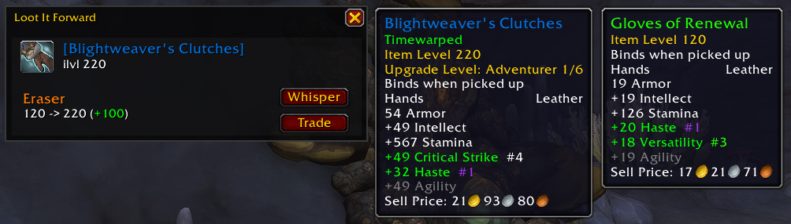
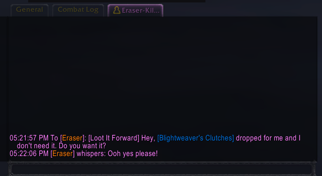

# Loot It Forward

You just picked up gear you don't need. Someone in your group could actually use it. Loot It Forward watches your loot drops and surfaces a popup whenever a piece you received is not an upgrade for you but would meaningfully upgrade a party member, so you can loot it forward instead of vendoring it.

## How It Works

When you receive gear in a dungeon, the addon compares your current item level in that slot to what the drop would give you. If it's not a self-upgrade, it checks every other party member: do they use this armor type? Does the weapon match their spec? Would it be a real ilvl jump for them? Any member who clears all three checks gets a row in the popup.

The popup lists each eligible candidate with their name (class-colored), current item level in the slot, and the delta they'd gain. Hovering the item shows a full tooltip comparison against the candidate's currently equipped gear. Two buttons per row let you whisper them directly or initiate a trade, and you can customize the whisper message template in settings. The popup is draggable and remembers where you put it across sessions.

Whisper or trade a candidate directly from the popup:

## Candidate Logic

- A group tool for dungeons and open-world play; open-world can be turned off in settings. Raids aren't supported.
- First, the item must not be an upgrade for you.
- From there, a party member qualifies as a candidate if the item:
  - is a higher item level than what they currently have equipped in that slot (heirloom gear is skipped while they're still leveling on it)
  - matches their armor type, or equipable weapon type
  - matches their spec's primary stat (if the item has one)

## Slash Commands

| Command | Description |
|---------|-------------|
| `/lif settings` | Open the settings panel to configure whisper templates, minimum party size, and other options |
| `/lif example` | Show an example popup (drag to reposition) |
| `/lif resetpos` | Reset popup to default position |
